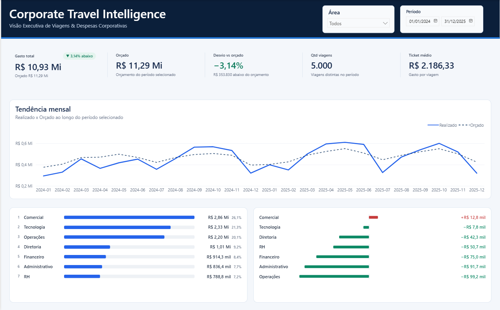
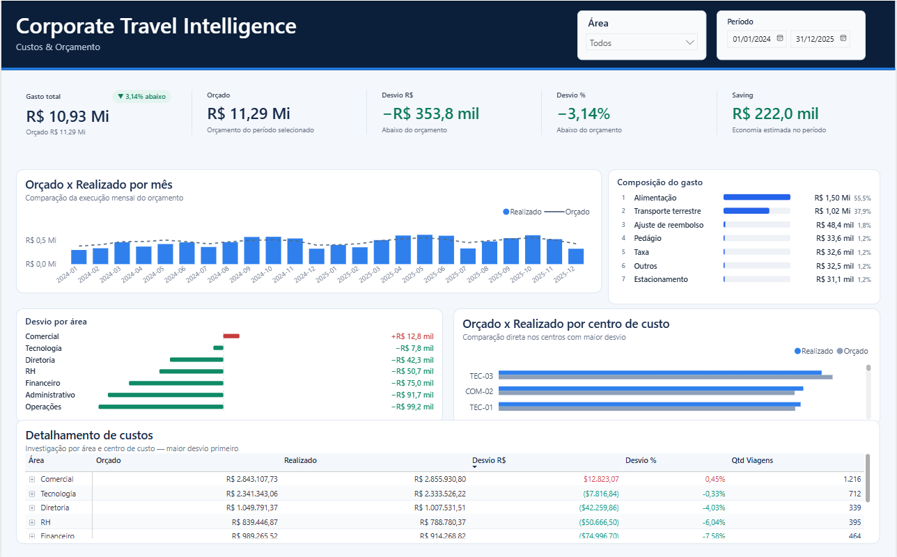
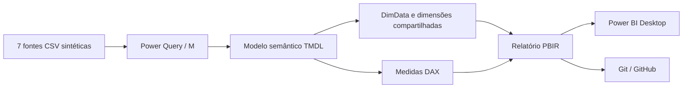

<div align="center">

# Corporate Travel Intelligence

### Inteligência financeira para transformar viagens corporativas em decisões claras de custo, orçamento e eficiência.


</div>

> **Projeto de portfólio com dados integralmente sintéticos.** Nenhum dado representa uma empresa, pessoa ou operação real.

O **Corporate Travel Intelligence** é uma solução de Business Intelligence desenvolvida em Power BI para acompanhar despesas de viagens, execução orçamentária e eficiência operacional. O projeto combina tratamento de dados, modelagem semântica, medidas DAX, design executivo e autoria versionável em PBIP/PBIR.

**7 fontes CSV · 5.000 viagens distintas · 2 páginas analíticas · modelo e relatório versionados como código**

## Visão geral

Custos de viagens normalmente estão distribuídos entre solicitações, despesas, orçamento, aéreo e hospedagem. Sem uma visão integrada, torna-se difícil responder rapidamente:

- Quanto foi gasto e como o realizado se compara ao orçamento?
- Quais áreas e centros de custo concentram os maiores desvios?
- Como o gasto evolui ao longo do tempo?
- Quais categorias explicam a composição das despesas registradas?

A solução consolida essas fontes em um modelo semântico com calendário e dimensões compartilhadas, oferecendo uma leitura executiva e uma camada de investigação financeira detalhada.

## Dashboard

### 01 · Visão Executiva

Leitura rápida da operação: gasto total, orçamento, desvio percentual, quantidade de viagens e ticket médio. A página combina tendência mensal, ranking de gasto e desvio orçamentário por área, com filtros de Área e Período.



### 02 · Custos & Orçamento

Aprofundamento financeiro por mês, categoria, área e centro de custo. Inclui composição das despesas, comparação entre realizado e orçamento, ranking de desvios e matriz para investigação dos valores.



## Indicadores e funcionalidades

- **Gasto Total e Orçado** com comparação no contexto dos filtros selecionados.
- **Desvio R$ e Desvio %**, onde valores positivos indicam gasto acima do orçamento e valores negativos indicam execução abaixo do orçamento.
- **Quantidade de viagens e Ticket Médio** calculados sobre viagens distintas.
- **Saving Estimado**, apresentado separadamente do desvio orçamentário e tratado como indicador experimental da fonte.
- **Tendência mensal** de realizado e orçamento pela dimensão calendário oficial.
- **Análises por área, categoria e centro de custo**, com rankings, barras proporcionais e detalhamento financeiro.
- **Filtros de Área e Período** aplicados ao realizado e ao orçamento por dimensões compartilhadas.

## Arquitetura técnica



- **Transformação:** tipagem, tratamento de datas, localidade numérica, duplicidades, grafias inconsistentes e campos ausentes no Power Query.
- **Modelagem:** fatos de viagens, despesas, orçamento, aéreo e hospedagem conectados a dimensões organizacionais, cadastrais e temporais.
- **Métricas:** medidas centralizadas em `_Medidas`, com `DimData` explícita e Auto Date/Time desativado.
- **Apresentação:** visuais nativos e HTML Content para KPIs, rankings e barras analíticas.
- **Versionamento:** páginas, visuais, medidas e metadados mantidos em PBIP, PBIR, TMDL, JSON e Markdown.

## Regra financeira central

```DAX
Desvio R$ = [Gasto Total] - [Orçado]
```

- **Maior que zero:** gasto acima do orçamento, situação desfavorável em vermelho.
- **Menor que zero:** gasto abaixo do orçamento, situação favorável em verde.
- **Igual a zero:** execução aderente ao orçamento.

O **Saving Estimado** utiliza o valor de referência da viagem, enquanto o desvio utiliza o orçamento aprovado. As duas métricas possuem bases diferentes e não devem ser reconciliadas como se representassem o mesmo conceito.

## Tecnologias

- **Power BI Desktop**, Power Query / M e DAX
- **PBIP, PBIR, TMDL e JSON** para autoria e versionamento
- **HTML Content** para componentes visuais orientados por medidas
- **Python** para geração determinística de dados sintéticos
- **Node.js** para automação da estrutura PBIR da Página 02
- **Git e GitHub** para controle de versão e documentação

## Como executar

1. Clone o repositório.
2. Abra [`Corporate_Travel_Intelligence.pbip`](Corporate_Travel_Intelligence.pbip) no Power BI Desktop.
3. Ajuste os caminhos locais dos CSVs nas consultas Power Query, se necessário.
4. Atualize os dados e navegue entre as páginas `01 - Visão Executiva` e `02 - Custos & Orçamento`.

Para validar a estrutura PBIR com o pacote `@microsoft/powerbi-report-authoring-cli` instalado:

```powershell
powerbi-report-author validate Corporate_Travel_Intelligence.Report --pretty
```

## Estrutura principal

```text
.
├── Corporate_Travel_Intelligence.pbip
├── Corporate_Travel_Intelligence.Report/
├── Corporate_Travel_Intelligence.SemanticModel/
├── assets/
├── docs/
├── scripts/
├── *_raw.csv
├── POWERBI_TECHNICAL_MAP.md
└── README.md
```

## Documentação técnica

- [Arquitetura](docs/architecture.md) — camadas, componentes e fluxo do projeto.
- [Regras de negócio](docs/business_rules.md) — semântica financeira, filtros e limitações.
- [Modelagem](docs/modeling.md) — tabelas, relacionamentos e calendário.
- [Dicionário de dados](docs/data_dictionary.md) — campos, tipos, grãos e chaves.
- [Dicionário de KPIs](docs/kpi_dictionary.md) — medidas DAX e interpretação.
- [ETL e qualidade](docs/etl.md) — transformações e controles de qualidade.
- [Design system](docs/design_system.md) — identidade visual e padrões de interface.
- [Decisões técnicas](docs/decisions.md) — ADRs e trade-offs do projeto.
- [Automação PBIR](docs/pbir_automation.md) — autoria, validação e guardrails.
- [Mapa técnico do Power BI](POWERBI_TECHNICAL_MAP.md) — páginas, visuais, medidas e caminhos dos artefatos.

## Limitações conhecidas

- As consultas M ainda utilizam caminhos absolutos para os CSVs e podem exigir ajuste em outra máquina.
- Os filtros de Área e Período usam os mesmos campos, mas ainda não estão sincronizados entre páginas.
- Os gráficos mensais das duas páginas apresentam sobreposição analítica.
- O orçamento não possui granularidade por categoria; por isso, a composição de despesas não representa uma decomposição do orçamento.
- Trinta viagens não reconciliam `saving_estimado = valor_referencia - gasto_total_realizado`; o Saving não deve ser tratado como métrica financeira auditada.
- O projeto não inclui refresh em nuvem, RLS, gateway ou integração com sistemas reais.

## Autor

**Marcos Ramos**
